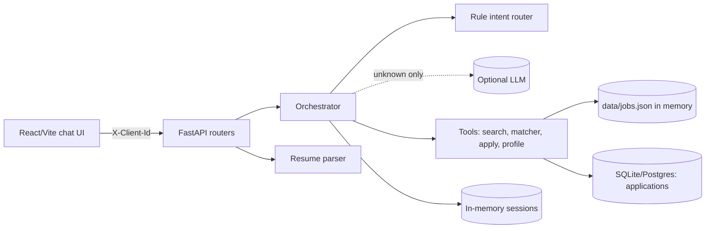

# JobPilot — AI Job Chat Assistant

Upload a PDF/DOCX resume in a chat, review/correct the extracted profile, get ranked job recommendations with transparent explanations, ask follow-ups in natural language, and track applications. Built for the Hidani Tech SDE Intern assessment.

> **Status honesty:** the app, tests and collector are implemented and tested. The real job dataset (`data/jobs.json`) is **not included yet**: the build sandbox could not reach any job site, so you must run the collector once (below). Until then the app starts and reports an empty dataset. No public deployment or GitHub repository has been created by this build.

## Features
- PDF/DOCX upload (type, magic-byte, size, page limits; OCR fallback only if `pdftoppm`+`tesseract` exist), upload progress, drag-and-drop.
- Rule-based extraction of name, contact, designation, skills, experience, education, projects, certifications; each field tagged `stated`/`inferred`/`user`; missing = "not specified".
- Edit the profile via a form or chat ("add skill Docker", "I have 3 years of experience", "I prefer remote").
- Search/filter via chat: remote/hybrid/onsite, skills, role, location, entry-level, max experience, employment type, "at least 80% match", "show more".
- Match score 0–100 with matched/related/missing skills, uncertainties and explanation; "Explain why job 3 matches".
- Apply flow with explicit confirmation; duplicate prevention; list/count/status; mark as applied.
- Optional LLM (Anthropic or OpenAI-compatible). Without a key everything works in a clearly disclosed fallback mode.

## Architecture

Dataflow: upload -> validate -> extract text -> Profile (session memory only) -> user confirms -> search + match -> cards -> "apply to job N" -> pending confirmation -> `applications` row.

## Layout
`backend/app/{routers,services,core}` · `backend/tests` · `frontend/src` · `scripts/collect_jobs.py` + `scripts/collector/` · `data/` · `docs/{DEMO,INTERVIEW}.md` · `Dockerfile`, `render.yaml`.

## Run locally
```bash
python -m venv .venv && . .venv/bin/activate
pip install -r backend/requirements-dev.txt
python scripts/collect_jobs.py            # produce data/jobs.json (see below)
cd frontend && npm install && npm run build && cd ..
cd backend && uvicorn app.main:app --port 8000      # serves API + built UI at http://localhost:8000 (docs at /docs)
# dev UI with hot reload: cd frontend && npm run dev  (proxies /api to :8000)
```

## Environment variables (`.env.example`)
`DATABASE_URL`, `JOBS_FILE`, `CORS_ORIGINS`, `MAX_UPLOAD_MB`, `LLM_PROVIDER` (none|anthropic|openai), `LLM_API_KEY`, `LLM_MODEL`, `LLM_BASE_URL`, `LLM_TIMEOUT_SECONDS`; collector: `COLLECTOR_CONTACT`, `ADZUNA_APP_ID`, `ADZUNA_APP_KEY`.

**LLM & privacy:** with a provider configured, only the user's chat message (never resume text/contact details) is sent, and only when rules can't route it (classification or brief advice). The LLM cannot run tools, SQL or network calls. Timeouts/failures fall back to basic mode.

## Job data
`python scripts/collect_jobs.py [--sources adzuna,arbeitnow,remotive,remoteok,jobicy] [--rebuild-only]`
- Sources are public APIs: Arbeitnow, Remotive, RemoteOK, Jobicy (keyless) and Adzuna (free key; best for India). Read each provider's terms before running; RemoteOK/Remotive require attribution/link-back, which cards provide via the original posting link.
- Checks robots.txt, identifying User-Agent, per-source pacing, retries with exponential backoff + `Retry-After`, never bypasses protections.
- Resumable (`data/raw/state.json` + JSONL checkpoints) and idempotent; dedupes by source ID, canonical URL, and title+company+location; validates against the `Job` schema; writes `data/quality_report.json`.
- If fewer than 1,500 listings are collected the script exits with code 2 and says so; add Adzuna keys or re-run. Nothing is synthesised.
- **Limits:** `last_verified_at` equals collection time only; listings may have closed; skills/experience are heuristic; most keyless sources are remote/global, so India-specific coverage needs Adzuna.
- **Unverified:** source response schemas follow public docs but could not be checked against live APIs from the sandbox; parsing is defensive, so report any mismatch.
- `tests/fixtures.py` holds synthetic jobs (`source_name=TEST_FIXTURE`) used only by tests; the UI shows a banner if such data is ever loaded.

## Matching algorithm
`score = 100 * Σ(weight·s) / Σ(weight)` over evaluable components: skills 50 (match=1, same-family skill=0.5), title 20 (token overlap with designation), experience 15 (under-qualified decays over 3 yrs; mild penalty if far over), location/arrangement 10, education 5 (only when the job states a degree). Missing information is excluded and reported, not scored zero. Confidence = high/medium/low by evaluable weight. It is a heuristic fit indicator, not a hiring probability.

## Applications
Table `applications` with `UNIQUE(client_id, job_id)`. States: `external_application_required` (recorded here, **not** submitted) and `applied_by_user` (user says they applied). Job title/company are snapshotted. The app never submits to employers.

## API
`GET /health` · `POST /api/resume/parse` (multipart `file`) · `POST /api/chat` `{"message"}` · `GET/PATCH /api/profile` · `GET /api/jobs?q=&skill=&remote=&location=` · `GET /api/jobs/{id}` · `POST /api/applications` `{"job_id"}` · `GET /api/applications[/{id}]`. All but health/jobs need header `X-Client-Id`. Errors: `{"error":{"code","message","recovery"}}`. Swagger at `/docs`.

## Security & privacy
Resumes stay in memory and are never written or logged; profiles live only in an in-memory session (TTL 120 min). Sessions are keyed by a random client ID with no authentication: anyone holding the ID can access that session and its applications, and sessions reset on restart. Inputs are treated as untrusted (resume text never reaches an LLM or triggers tools; apply needs a user confirmation). Parameterised ORM, CORS allow-list, generic 500s, DOCX zip-bomb guard.

## Tests (actual results from the build sandbox)
- Backend: `cd backend && pytest` -> **56 passed** (parsing PDF/DOCX/corrupt/missing, filtering, matching, unknown IDs, apply/duplicates/status, "apply to job 3", LLM failure, invalid payloads, health, session isolation, collector with mocked HTTP).
- Frontend: `cd frontend && npm test` -> **6 passed**; `npm run build` (type-check + Vite) succeeds.
- Manual (curl, fixture data): upload -> confirm -> search -> apply -> duplicate -> list -> restart persistence -> isolation.
- **Not performed:** live collection, live LLM calls, Docker build, real deployment, browser/screenshot testing, scanned-PDF OCR on a real scan.

## Deployment (Render example)
Push to GitHub with `data/jobs.json` committed, create a Render Web Service from the repo (`render.yaml` / Dockerfile), set `LLM_*` secrets if wanted, keep the 1 GB disk at `/var/data` for SQLite (or point `DATABASE_URL` at managed Postgres). Verify `/health`. Frontend and API share one origin, so no CORS setup is needed.

## Screenshots
Add real screenshots to `docs/screenshots/` after running the app and link them here.

## Known limitations / future work
Regex resume parsing misses unusual layouts; OCR is best-effort; in-memory sessions don't scale across instances (use Redis); no auth; `create_all` instead of Alembic migrations; no streaming; keyword/skill taxonomy is finite (embeddings would help).
